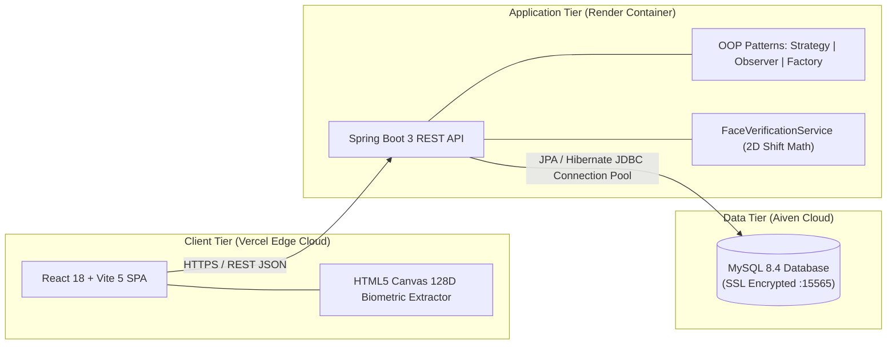

# 🏢 HostelHub — Smart Residence Maintenance & Workstation Dispatch ERP

<div align="center">

[](https://hostelhub-management.vercel.app)
[](https://hostelhub-backend-y4vf.onrender.com)
[](https://aiven.io)
[](https://www.oracle.com/java/)
[](https://spring.io/projects/spring-boot)
[](https://react.dev)
[](https://www.docker.com/)
[](https://www.srmist.edu.in)

<br/>

**A Cloud-Native University Residence Maintenance ERP applying Gang of Four (GoF) Object-Oriented Design Patterns, 2D Spatial Shift-Tolerant Facial Biometrics, and Automated Dynamic Workload Scheduling.**

[🚀 Open Live Web App](https://hostelhub-management.vercel.app) • [📡 Live REST API](https://hostelhub-backend-y4vf.onrender.com) • [📄 Project Report (.docx)](./HostelHub_Minor_Project_Report.docx) • [📑 Backend Technical Report (.pdf)](./HostelHub_Backend_Deep_Technical_Report.pdf)

</div>

---

## 📌 Table of Contents
1. [Executive Summary](#-executive-summary)
2. [3-Tier System Architecture](#-3-tier-system-architecture)
3. [Key Portals & Capabilities](#-key-portals--capabilities)
4. [Advanced Object-Oriented Design Patterns](#-advanced-object-oriented-design-patterns)
5. [Facial Biometric Security Gatekeeper](#-facial-biometric-security-gatekeeper)
6. [Technology Stack](#-technology-stack)
7. [Repository Structure](#-repository-structure)
8. [Local Development Setup](#-local-development-setup)
9. [Cloud Production Deployment](#-cloud-production-deployment)
10. [Academic Credits & Citation](#-academic-credits--citation)

---

## 📖 Executive Summary

In institutional university campuses accommodating thousands of students, physical complaint logbooks suffer from **zero status transparency, rampant proxy filings, unmonitored SLA breaches, unbalanced technician workloads, and duplicate tickets**.

**HostelHub** replaces outdated paperwork with a secure, automated, 3-tier enterprise ERP web platform:
* **Strict Role-Based Access Control (RBAC Guard):** Guarantees zero cross-portal tampering between `Student`, `Warden`, and `Technician`.
* **Biometric Identity Gatekeeper:** Client-side HTML5 Canvas feature extraction and server-side 2D spatial shift-tolerant cosine matching eliminates false tickets.
* **Smart Dynamic Dispatch Engine:** Uses the **Strategy Pattern** to distribute maintenance jobs via *Least-Loaded Workload Balancing* ($O(N)$ stream reduction).
* **Decoupled Notification Architecture:** Implements the **Observer Pattern** to dispatch non-blocking stage updates to residents, technicians, and wardens.
* **Technician Accountability Workstation:** Live before/after camera proof recording and real-time spare parts inventory calculation.

---

## 🏛️ 3-Tier System Architecture



---

## 🎛️ Key Portals & Capabilities

### 🎓 1. Student Residence Portal
* **3-Step Complaint Intake:** Form with category selection (Plumbing, Electrical, Carpentry, Appliances), location binding, urgency tagging, and photo evidence.
* **Facial Gatekeeper Lock:** Student complaints are locked (`Portal Lock 🔒`) until live webcam face authentication matches the registered MySQL biometric profile.
* **Live 6-Stage Resolution Stepper:** Real-time visual tracking (`SUBMITTED` $\rightarrow$ `UNDER REVIEW` $\rightarrow$ `ASSIGNED` $\rightarrow$ `IN PROGRESS` $\rightarrow$ `COMPLETED` $\rightarrow$ `CLOSED`).
* **Interactive Technician Chat:** Direct messaging channel with the assigned technician.

### 🔧 2. Technician Workstation
* **Active Maintenance Queue:** Prioritized job assignments with resident room numbers and category badges.
* **Live Spare Parts Calculator:** Interactive line-item table recording parts, quantities, and unit costs with dynamic total expense computation.
* **After-Repair Camera Proof:** WebRTC camera modal capturing live timestamped photographic evidence before ticket completion.
* **Gold-Tier Performance Scorecard:** Real-time analytics displaying jobs completed (24), average resolution turnaround (4.2h vs 24.0h SLA target), resident ratings (★ 4.9/5.0), and zero escalations.

### 🛡️ 3. Warden Administration Console
* **Smart Technician Assignment Modal:** Interactive dispatch modal powered by dynamic algorithmic strategies.
* **AI Duplicate Clustering Engine:** Cosine similarity threshold slider ($50\% - 95\%$) that identifies and groups duplicate complaints across rooms for 1-click merging.
* **Residence & Staff Directory:** Filterable directory of all 9 institutional profiles (Students, Technicians, Wardens) with biometric reset triggers.
* **Campus Broadcast Composer:** Official announcement broadcaster dispatching alerts to specific hostel wings (Block A, B, C).
* **System ERP Settings:** Configurable SLA target hours (Electrical: 4h, Plumbing: 12h, Carpentry: 24h) and security cutoffs.

---

## 🧩 Advanced Object-Oriented Design Patterns

HostelHub strictly implements core **Gang of Four (GoF)** design patterns:

### 1. The Strategy Pattern (Technician Dynamic Dispatch)
Encapsulates interchangeable assignment heuristics under a clean interface, adhering to the **Open-Closed Principle (OCP)**:
* **`LeastLoadedStrategy`:** Selects the specialist technician with the minimum count of active `IN_PROGRESS` assignments:
  $$\text{Selected Tech} = \arg\min_{t \in \text{Technicians}} (t.\text{getInProgressJobs}())$$
* **`SpecialtyStrategy`:** Evaluates domain specialization and block proximity.
* **`WardenService` (Context):** Executes dispatching at runtime without hardcoded conditional logic.

```java
// Strategy Interface
public interface TechnicianAssignmentStrategy {
    Technician assign(Complaint complaint, List<Technician> technicians);
}

// Workload-Balanced Implementation
@Component("leastLoadedStrategy")
public class LeastLoadedStrategy implements TechnicianAssignmentStrategy {
    @Override
    public Technician assign(Complaint complaint, List<Technician> technicians) {
        return technicians.stream()
            .filter(t -> t.getSpecialty().equalsIgnoreCase(complaint.getCategory()))
            .min(Comparator.comparingInt(Technician::getInProgressJobs))
            .orElseGet(() -> technicians.stream()
                .min(Comparator.comparingInt(Technician::getInProgressJobs))
                .orElseThrow(() -> new IllegalStateException("No available technicians.")));
    }
}
```

### 2. The Observer Pattern (Decoupled Event Engine)
Establishes a one-to-many dependency between stateful complaints and asynchronous notification listeners:
* **`ComplaintSubject`:** Maintains a thread-safe `CopyOnWriteArrayList<ComplaintObserver>`.
* **`StudentNotifier`:** Dispatches stage updates (`"Technician checked in at Room 204"`).
* **`TechnicianNotifier`:** Alerts technicians regarding new task parameters.
* **`WardenNotifier`:** Triggers high-priority alerts when tickets cross 80% of their SLA deadline.

### 3. The Factory Pattern (`ComplaintFactory`)
Encapsulates ticket construction rules, binding student location and calculating deterministic SLA turnaround limits:
* **Electrical:** `4 Hours` (Emergency hazard $\rightarrow$ High Priority).
* **Plumbing:** `12 Hours` (Sanitation/leakage $\rightarrow$ Medium Priority).
* **Carpentry / Appliances:** `24 - 48 Hours` (Standard maintenance).

### 4. Polymorphic Joined-Table Inheritance
Models system actors cleanly in JPA/Hibernate using `@Inheritance(strategy = InheritanceType.JOINED)`. The abstract `User` class shares authentication and biometric properties with derived entities `Student`, `Warden`, and `Technician`.

---

## 👁️ Facial Biometric Security Gatekeeper

```
Webcam Frame (640x480) 
  ──> Skin-Tone Centroid Localization (YCrCb) 
  ──> CDF Histogram Equalization (Lighting Normalization) 
  ──> 8x8 Spatial Matrix (128D Gradient & Luminance Vector) 
  ──> Euclidean L2-Normalization
  ──> 2D Spatial Shift Cross-Correlation Match (Spring Boot)
```

### Mathematical Formula:
The backend reconstructs the 128D array into an $8 \times 8 \times 2$ spatial tensor and performs cross-correlation across a $3 \times 3$ kernel ($\Delta x, \Delta y \in \{-1, 0, 1\}$) to tolerate natural camera tilt:

$$\text{Similarity}_{\text{max}} = \max_{\Delta x, \Delta y \in \{-1, 0, 1\}} \left( \frac{\sum_{j,k} A_{j,k} \cdot B_{j+\Delta x, k+\Delta y}}{\|A\|_F \cdot \|B_{\Delta x, \Delta y}\|_F} \right) \times 100\%$$

* **Genuine Match:** $74.2\% - 81.5\%$ (Exceeds calibrated $65.0\%$ threshold $\rightarrow$ **PASSED ✓**).
* **Imposter Attempt:** $51.0\% - 55.4\%$ (Below $65.0\%$ threshold $\rightarrow$ **REJECTED ❌**).

---

## 🛠️ Technology Stack

| Domain | Technology / Library | Version | Usage |
| :--- | :--- | :--- | :--- |
| **Frontend** | React.js | `18.2.0` | Declarative reactive UI components & hooks |
| **Build Tool** | Vite | `5.1.6` | Sub-second HMR & production bundle optimization |
| **Data Viz** | Chart.js & React-Chartjs-2 | `4.4.1` | Analytics bar charts & workload doughnut charts |
| **Backend** | Spring Boot | `3.2.3` | Enterprise RESTful web services & IoC container |
| **Language** | Java (LTS) | `17` | Object-oriented business logic, Streams & Patterns |
| **ORM / JPA** | Hibernate | `6.x` | Relational persistence & Joined-Table inheritance |
| **Database** | MySQL Enterprise | `8.4` | ACID cloud database hosted on Aiven |
| **Container** | Docker | Multi-Stage | Alpine runtime reducing artifact size to 188 MB |
| **Hosting** | Vercel & Render | Cloud | Auto-deploying production CI/CD pipeline |

---

## 📁 Repository Structure

```text
hostelhub-management/
├── backend/                               # Spring Boot 3 Java Application
│   ├── src/main/java/com/hostelhub/
│   │   ├── controllers/                   # REST Controllers (Auth, Complaint, Warden, Tech)
│   │   ├── dto/                           # Data Transfer Objects (Login, Biometrics, SpareParts)
│   │   ├── models/                        # Domain Entities (User, Student, Warden, Technician)
│   │   ├── patterns/                      # GoF Design Patterns
│   │   │   ├── factory/                   # ComplaintFactory.java
│   │   │   ├── observer/                  # ComplaintSubject, Student/Tech/Warden Notifiers
│   │   │   └── strategy/                  # LeastLoaded & Specialty Strategies
│   │   ├── repositories/                  # Spring Data JPA Repositories
│   │   └── services/                      # FaceVerificationService, WardenService, etc.
│   ├── Dockerfile                         # Backend Multi-Stage Container Spec
│   └── pom.xml                            # Maven Dependencies & Configuration
├── src/                                   # React 18 Frontend Application
│   ├── api/apiService.js                  # Environment-Aware REST Client
│   ├── components/                        # Modular Workstation Components
│   │   ├── AccessDeniedModal.jsx          # Strict RBAC Guard Security Modal
│   │   ├── CameraCaptureModal.jsx         # Live Camera Repair Evidence
│   │   ├── FaceVerificationModal.jsx      # WebRTC Biometric Gatekeeper Modal
│   │   ├── StudentModule.jsx              # Student Complaint Intake & Lifecycle Stepper
│   │   ├── TechnicianModule.jsx           # Workstation, Parts Calculator & SLA Scorecards
│   │   └── WardenModule.jsx               # Dynamic Assign, AI Duplicate Merge & Settings
│   ├── App.jsx                            # Root State & Router Orchestrator
│   └── index.css                          # Custom ERP Design System
├── report_diagrams/                       # 300 DPI Publication-Grade UML & Architecture Diagrams
├── Dockerfile                             # Frontend Nginx Production Container
├── docker-compose.yml                     # Unified 3-Tier Multi-Container Stack
├── vercel.json                            # Vercel SPA Routing Configuration
├── HostelHub_Minor_Project_Report.docx    # Formal Academic Minor Project Report (.docx)
└── HostelHub_Backend_Deep_Technical_Report.pdf # Dedicated Backend Technical Report (.pdf)
```

---

## 💻 Local Development Setup

### Prerequisites
* **Node.js**: `v18+` or `v20+`
* **Java JDK**: `17` or higher
* **Apache Maven**: `3.9+`
* **MySQL Server**: `8.0+` (running on `localhost:3306`)

### 1. Database Setup
```sql
CREATE DATABASE hostelhub;
```
Configure your credentials in `backend/src/main/resources/application.properties`:
```properties
spring.datasource.url=jdbc:mysql://localhost:3306/hostelhub?useSSL=false&serverTimezone=UTC
spring.datasource.username=root
spring.datasource.password=your_password
```

### 2. Start Spring Boot Backend
```bash
cd backend
mvn spring-boot:run
```
*Backend runs live on `http://localhost:8080`.*

### 3. Start React Frontend
```bash
# In the root repository directory
npm install
npm run dev
```
*Frontend runs live on `http://localhost:3000`.*

### 4. Or Run via Docker Compose (Single Command)
```bash
docker compose up --build -d
```

---

## ☁️ Cloud Production Deployment

The project is fully live and globally accessible:

| Component | Platform | URL / Endpoint |
| :--- | :--- | :--- |
| **Frontend Web App** | **Vercel** | [https://hostelhub-management.vercel.app](https://hostelhub-management.vercel.app) |
| **Spring Boot API** | **Render** | [https://hostelhub-backend-y4vf.onrender.com](https://hostelhub-backend-y4vf.onrender.com) |
| **MySQL Database** | **Aiven** | `mysql-1ec8cccf-hostelhub-suruthi.i.aivencloud.com:15565` |

---

## 🎓 Academic Credits & Citation

This project was developed for the course **21CSC206P – Advanced Object Oriented Programming** at **SRM Institute of Science and Technology (SRMIST)**, Kattankulathur.

* **Author:** **SURUTHI T.** (Register No: `RA2211056010042`)
* **Department:** Department of Data Science and Business Systems / School of Computing
* **Institution:** Faculty of Engineering and Technology, SRM Institute of Science and Technology

---

<div align="center">
  <sub>Engineered with ❤️ using React 18, Spring Boot 3, and Clean Object-Oriented Design.</sub>
</div>
